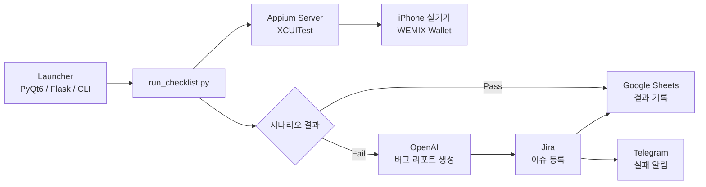

# IOSWM — WEMIX Wallet iOS 회귀 테스트 자동화

Appium(XCUITest)으로 iOS 실기기에서 **WEMIX Wallet 회귀 체크리스트를 처음부터 끝까지 자동 실행**하고,
실패가 나면 **LLM 버그 리포트 작성 → Jira 이슈 등록 → Telegram 알림**까지 사람 손 없이 이어지는 QA 파이프라인입니다.

> 블록체인 지갑 QA 업무 중, 배포 때마다 반복되던 수동 체크리스트 검증을 줄이기 위해 직접 설계·구현했습니다. (2024.04, 1인 개발)

## 핵심 기능

- **E2E 회귀 자동화** — 지갑 생성/복구, 송금·수신, 스왑, NFT, 설정 등 체크리스트 58개 항목 중 48개를 실기기에서 자동 검증
- **결과 자동 기록** — 항목별 Pass / Fail / Not Test 와 실패 로그를 Google Sheets 체크리스트에 실시간 기록
- **실패 → 이슈 자동화** — 예외 로그를 OpenAI API로 "사전 조건 / 재현 절차 / 실제 결과 / 기대 결과" 형식의 리포트로 변환해 Jira 버그로 등록하고, 이슈 링크를 시트와 Telegram으로 전달
- **비개발자용 실행 환경** — PyQt6 데스크톱 런처(진행률·결과 뷰)와 Flask 웹 트리거로 터미널 없이 실행
- **TC 초안 생성 도구** — 기획서 PDF를 읽어 테스트 케이스 초안을 생성하는 보조 스크립트

## 동작 흐름



1. 실행 시작 알림을 Telegram으로 보내고 Appium 세션을 연다.
2. `scenarios/` 의 시나리오를 체크리스트 순서대로 실행한다. (시나리오 1개 = 모듈 1개 = 체크리스트 1~3행)
3. 성공하면 시트에 `Pass` 를 기록하고 다음 시나리오로 넘어간다.
4. 실패하면 로그 기록 → LLM 리포트 → Jira 이슈 → 알림을 처리한 뒤, 후속 시나리오가 깨진 상태에서 오탐을 내지 않도록 실행을 중단한다.
5. 종료 시 총 소요 시간을 알린다. (1회 실행 약 7~10분)

## 기술 스택

| 구분 | 사용 기술 |
| --- | --- |
| 언어 | Python 3.12 |
| 모바일 자동화 | Appium (XCUITest), Selenium WebDriver |
| 리포팅 연동 | OpenAI API, Jira REST API (`jira`), Google Sheets API (`gspread`), Telegram Bot API |
| 실행 UI | PyQt6 + qt-material, Flask |
| 설정 관리 | python-dotenv (인증·기기·지갑 정보를 환경 변수로 분리) |

## 테스트 커버리지

| 영역 | 주요 시나리오 | 우선순위 |
| --- | --- | --- |
| 앱 실행 / 온보딩 | 앱 실행, Splash & Intro 문구 검증 | High / Low |
| 지갑 생성·복구 | 새 지갑 생성, 비밀문구로 기존 지갑 복구, 지갑 연결 해제 | High |
| Balance | QR 스캔, 알림, 지갑 목록·전환·추가·불러오기, 주소 복사, 보내기, 받기 | High / Medium |
| My assets | 자산 조회, 보내기·받기·교환, News / About / History | High / Low |
| PoET | 리워드 영역 확인 및 수령 | Medium |
| History | 거래내역, 상세 화면, Explorer 이동 | Medium |
| Exchange | WEMIX ↔ WEMIX$ 양방향 스왑 | High |
| NFT / Featured | 목록 및 화면 출력 확인 | Medium |
| 설정 | 비밀번호 변경, 자동 잠금, 비밀문구·프라이빗 키 확인, 지갑 관리, 약관·버전 정보 | High ~ Low |

생체 인식, 외부 서비스 이동, dApp 세션 해제처럼 자동화 신뢰도가 낮은 항목은 `Not Test` 로 표기해 수동 검증 대상으로 남깁니다.
TestFlight 기반 설치/업데이트 시나리오(`update_app`, `remove_install`)는 작성되어 있으나 기본 실행에서는 꺼져 있습니다.

## 프로젝트 구조

```
.
├── run_checklist.py        # 실행 진입점: 세션 생성 → 시나리오 순차 실행 → 종료 알림
├── config.py               # .env 기반 설정 로더 (필수 값 누락 시 즉시 실패)
├── scenarios/              # 체크리스트 시나리오 50개 (send.py, swap.py, recover_wallet.py ...)
├── reporting/
│   └── telegram_chat.py    # 시작 / 실패 / 종료 알림
├── gui/
│   ├── launcher.py         # 프로젝트·OS·테스트 종류 선택 런처
│   └── progress_view.py    # 진행률 및 체크리스트 결과 뷰
├── web/
│   └── app.py              # 원격 실행/중지용 Flask 엔드포인트
├── tools/                  # 기획서 PDF → TC 초안 생성 스크립트
├── assets/                 # GUI 리소스
├── data/                   # 체크리스트 템플릿(xlsx)
├── .env.example
└── requirements.txt
```

## 실행 방법

**사전 준비**: macOS + Xcode, Appium Server(XCUITest driver), 개발자 서명된 iOS 실기기, 대상 앱 설치

```bash
git clone https://github.com/Chriskim0205/IOSWM.git
cd IOSWM
python -m venv .venv && source .venv/bin/activate
pip install -r requirements.txt

cp .env.example .env        # API 키, 기기 UDID, 테스트 지갑 정보 입력
appium --base-path /wd/hub  # 별도 터미널

python run_checklist.py     # CLI 실행
python gui/launcher.py      # 또는 데스크톱 런처
python web/app.py           # 또는 웹 트리거 (http://localhost:5005)
```

TC 초안 생성:

```bash
python tools/generate_tc_app.py path/to/spec.pdf
```

> 테스트 지갑은 실자산이 없는 전용 지갑만 사용합니다. `.env` 와 서비스 계정 키는 커밋하지 않습니다.

## 설계 메모

- **Fail-fast**: 지갑 상태가 시나리오 간에 이어지므로, 한 단계가 실패하면 이후 결과를 신뢰할 수 없다고 보고 즉시 중단합니다.
- **사람이 읽는 이슈**: 원시 예외 로그 대신 재현 절차 형식으로 정리된 이슈가 등록되어, 개발자가 시트와 로그를 오가지 않아도 됩니다.
- **기존 QA 프로세스 유지**: 팀이 쓰던 체크리스트 시트와 Jira 워크플로를 그대로 결과 저장소로 사용해 도입 비용을 없앴습니다.

## 한계와 개선 방향

- 시나리오마다 반복되는 실패 처리 블록(시트 기록 → LLM → Jira → 알림)을 공통 리포터로 추출
- 절대 XPath 의존도를 낮추고 accessibility id 기반 로케이터 + Page Object 로 전환
- `pytest` 기반으로 옮겨 시나리오 단위 실행·재시도·리포트(Allure) 지원
- 고정 대기(`sleep`)를 명시적 대기로 교체해 실행 시간과 flaky 실패 감소
- Android(UiAutomator2) 확장 및 CI 스케줄 실행
